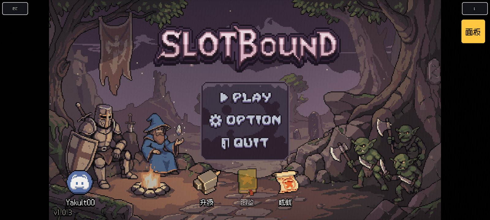
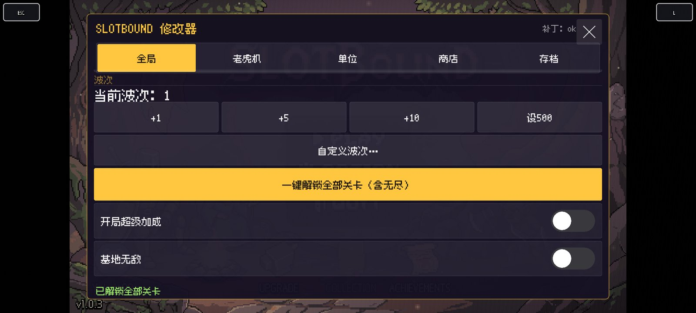

# SlotBound 安卓版

把 PC 游戏 SlotBound 搬到安卓手机上玩。SlotBound 是一款老虎机肉鸽游戏（拉老虎机打怪、攒遗物、闯关），原本只有 PC 版，没有官方手游。这个项目把 PC 最新版（v1.0.3）的游戏包打进 LÖVE 11.5 引擎，编译成一个单体 APK，装上就能直接玩，存档、道具、关卡都和 PC 版一样。

游戏本体与 iOS 移植版（[Yakult00/Slotbound-iOS](https://github.com/Yakult00/Slotbound-iOS)）同源，操作、面板、版本号都对齐。

游戏版权归原作者 Optima Arch 所有，本项目是个人移植分享，仅供学习交流，请支持正版原作。仓库里的构建脚本以 MIT 许可开源（见 [LICENSE](LICENSE)），游戏本体不在许可范围（见 [NOTICE.md](NOTICE.md)）。


## 截图



*游戏实机：启动即全屏，右上角是辅助面板的悬浮按钮*



*辅助面板：SLOTBOUND 修改器（全局 / 老虎机 / 单位 / 商店 / 存档），内置中文*

## 安装方法

1. 到 Release 下载 `SlotBound.apk`。
2. 手机上直接点击安装（需要允许「安装未知来源应用」）。
3. 打开游戏即可，不需要额外的 LÖVE 播放器，也不需要手动放 `game.love`。

- 包名：`com.yakult00.slotbound`，应用名 SlotBound，纯横屏
- 只出 arm64-v8a（现代安卓手机都是这个架构）
- 测试机：OnePlus 9RT / Android 12

## 触屏操作

游戏原本是 PC 鼠标操作，触屏做了与 iOS 版一致的适配：

- **长按士兵**：查看士兵详情（只对已选中的士兵生效，拖动士兵时不触发）。
- **长按道具**：使用道具。
- **购买道具 / 升级树升级 / 选择专职**：点一下悬浮到图标上，再点一下确定。
- **列表**：拖动滚动。
- **升级树**：拖动平移，双指放缩（仅升级树可用）。
- **左上角 ESC 按钮**：返回，相当于键盘 Esc。

> 操作方案与 iOS 版完全相同。遇到手感问题（点击没反应、拖不动、误触）欢迎在 Issues 里说明机型和场景。

## 游戏辅助（内置面板）

面板直接打包在游戏里，**不用另外装任何文件**：游戏启动后右上角有一个黄色的「面板」悬浮按钮，点开就是修改器，关闭面板回到游戏。

- 五个页面：全局（波次、一键解锁关卡、开局加成、基地无敌）/ 老虎机 / 单位 / 商店 / 存档
- 左上角 `补丁: ok` 表示后端已加载，功能可用
- 面板不修改游戏文件，只改运行时的数值；退出游戏即恢复原样

面板后端是纯 Lua（`trainer_backend.lua`），和游戏一起打进 `game.love`，因此不受安卓不允许 JIT 的限制——iOS 那种 dylib 面板在安卓上用不了，这套是重新做的安卓内置版。

## 版本对照

| 安卓版 | 基于 PC 版 | 说明 |
|---|---|---|
| v1.0.0 | v1.0.3 | 首个正式版，内置中文面板，启动全屏 |

游戏内容与 iOS 移植版同步，iOS 的版本对照见[那边仓库](https://github.com/Yakult00/Slotbound-iOS)。

## 项目结构

仓库只放构建脚本和外壳资源，100 MB 的游戏本体不进 git，作为 release 资产单独管理：

```
Slotbound-APK/
├── .github/
│   ├── workflows/android.yml          # 编译流水线（拉游戏包 → 编译 → 校验签名 → 上传 artifact）
│   └── ISSUE_TEMPLATE/bug_report.yml  # 问题反馈模板
├── android/
│   └── res/drawable/icon.png   # 应用图标
├── patches/
│   └── arm64-only.patch   # 只编 arm64-v8a，砍掉其余 ABI
├── tools/
│   ├── game_love.sha256   # 游戏本体 pin（sha256 + 文件名）
│   └── patch_android_project.py   # 改 love-android 工程的包名/图标/版本号
├── docs/                  # README 截图
├── CHANGELOG.md
├── LICENSE                # MIT，只覆盖脚本与文档，不含游戏本体
├── NOTICE.md              # 游戏本体版权与许可范围
├── .gitattributes         # 标记二进制资源，避免换行转换
└── README.md
```

游戏本体（`game.love`，约 101 MB）放在 release 资产 `game-latest` 里，构建时下载并校验哈希，所以本仓库与 iOS 仓库完全解耦——iOS 那边改代码不影响这里出包。

## 构建

Actions 页 → Build Android APK → Run workflow。流水线做的事：

1. `gh release download game-latest` 拉 `game.love`，`sha256sum -c tools/game_love.sha256` 校验
2. 从版本号派生 `versionName` / `versionCode`
3. checkout `love-android`，打 `arm64-only.patch`，拷入 `game.love` 和图标
4. 解出签名密钥，改包名/图标/版本号
5. 编译 release APK（gradle + NDK 走缓存，冷缓存约 6–7 分钟，命中后约 4–5 分钟）
6. `apksigner verify` 校验签名，产物 `SlotBound.apk` 只出 workflow artifact，不自动发 Release

> 自己 fork 之后要出包，得先在仓库的 Settings → Secrets and variables → Actions 里配 4 个 secret：`ANDROID_KEYSTORE_BASE64`（keystore 文件的 base64）、`ANDROID_KEYSTORE_ALIAS`、`ANDROID_KEYSTORE_KEYPASSWORD`、`ANDROID_KEYSTORE_STOREPASSWORD`，少一个就会在 `Decode keystore` 那步失败。只想装来玩的话，把签名步骤换成 debug 签名即可。

### 更新游戏本体

```bash
gh release upload game-latest game.love --clobber -R Yakult00/Slotbound-APK
sha256sum game.love        # 把新哈希写进 tools/game_love.sha256
```

改了 pin 再触发构建，`Fetch game.love payload` 这一步会挡住哈希不符的包。

## 移植说明

- 游戏数据来自 PC 最新版（2080 个文件 = 2079 个游戏文件 + 面板 `sb_panel.lua`），官方原有的加密容器已逆向解出，`game.love` 就是解开的游戏包。
- 与 iOS 版的差别只在引擎外壳：iOS 编成未签名 IPA 用 LiveContainer 装，安卓编成 APK 直接装；游戏内逻辑（`main.lua` 垫片的触屏适配、运气/保底系统、`trainer_backend.lua`）沿用同一份。
- 启动全屏由包内 `main.lua` 调 `love.window.setFullscreen(true)` 实现，系统状态栏和导航栏都不显示。
- `game.love` 里共 69 个 `.lua`，其中 64 个是 LuaJIT 字节码（不是源码），在 GitHub 上打开会显示二进制；另外 5 个是源码（`main.lua`、`conf.lua`、`sb_panel.lua`、`trainer_backend.lua`、`release_integrity.lua`），图片、音乐、配置文件可以直接浏览。
